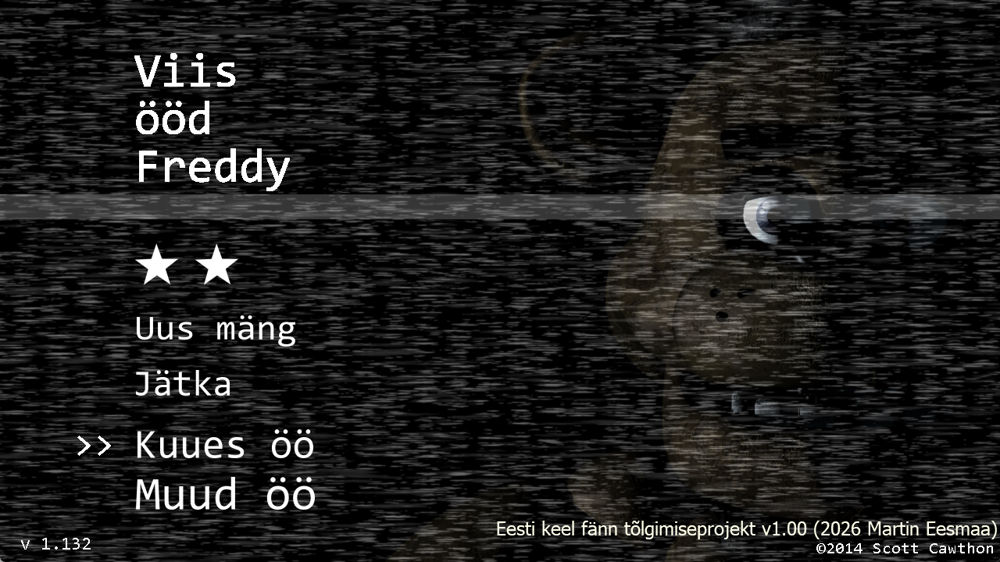

# FNAF-mods

Five Nights at Freddy's mods

## Requirements

You need to mod or/and develop the fan mod game by

- Latest version copy of Five Nights at Freddy's (v1.132)
- Clickteam Fusion 2.5 (paid developer for executable applications, free only for HTML5 export)
- Perspective.mfx extension module installed
- HDiffPatch
- Original MFA source project file (must have reverse engineered to dump MFA file with NebulaFD)
- Delta Patcher to patch xdelta file

## Result screenshots

Martin Eesmaa's Estonian fan translation project of FNAF 1 at title screen:



More screenshots are in folder: [screenshots](screenshots)

## Run the game

Ensure you have original Five Nights at Freddy's for Windows executable version and make sure SHA256 checksum is matched of v1.132:

```text
SHA256: 862cd7ab7c81b20a4e848888bc2493dda0181759c39958a42cc5c3d02dfb195a
```

Reminder: If you love the game, please consider support the creator, purchase the game or/and also donate to Scott Cawthon for his hard work done.

If the file is identical, it is ready to go.

Otherwise, if the file is different. It may be:

- Wrong version/copy or different checksum
- Size is too small
- Disk space full

Please try it again and if the problem persists, please feel free to create an issue.

[Link of releases](https://github.com/MartinEesmaa/FNAF-mods/releases) contains patch xdelta file from original FNAF game of Windows version for update mod.

Please be aware that it will contain only patch file to avoid violating copyright infringements for use of prebinary executable modded file.

Diff patch file can be applied from original FNAF game to modded game:

```patch
hpatchz "Five Nights at Freddy's.exe" patchmod.xdelta FNAF-samplemod.exe
```

Or [Delta Patcher](https://github.com/marco-calautti/DeltaPatcher/releases) via GUI.

## Patches mod

Nightly patches are available for example [EESTImod](EESTImod) folder of my Estonian translation fan project.

Also source modified assets are still available on [EESTImod/src](EESTImod/src)

- Martin Eesmaa
